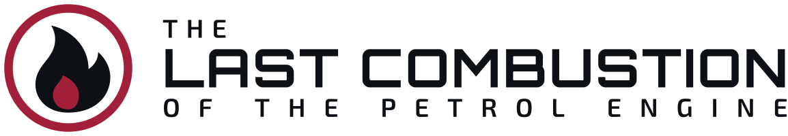
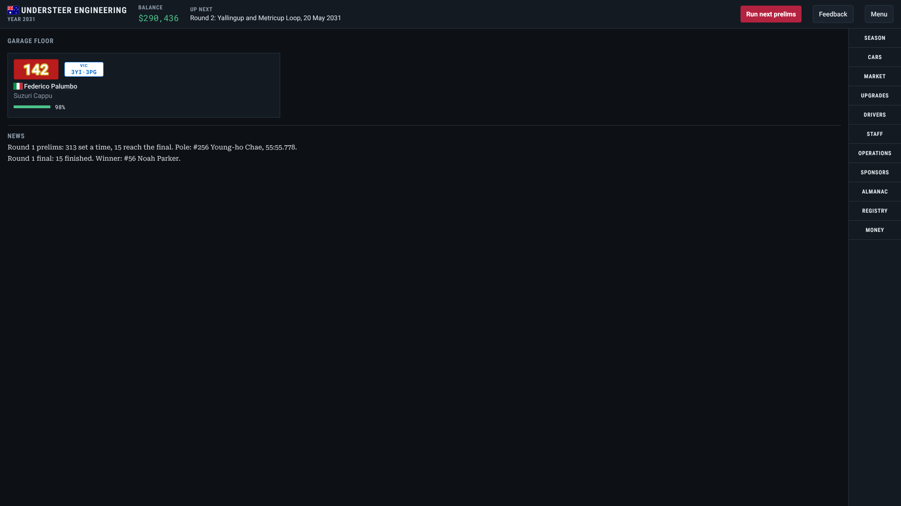
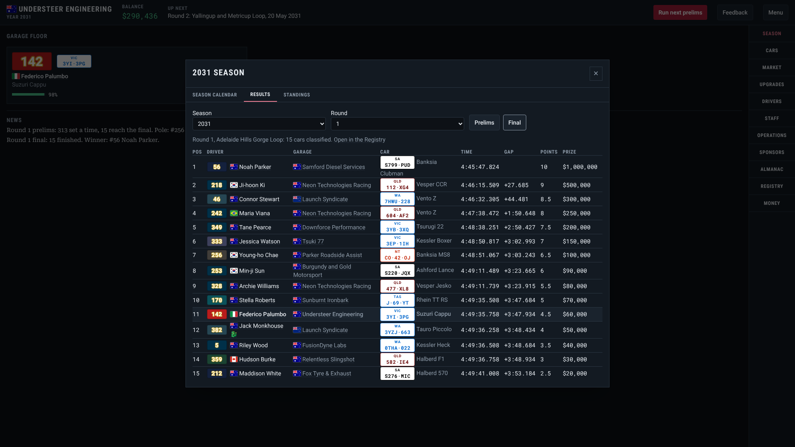
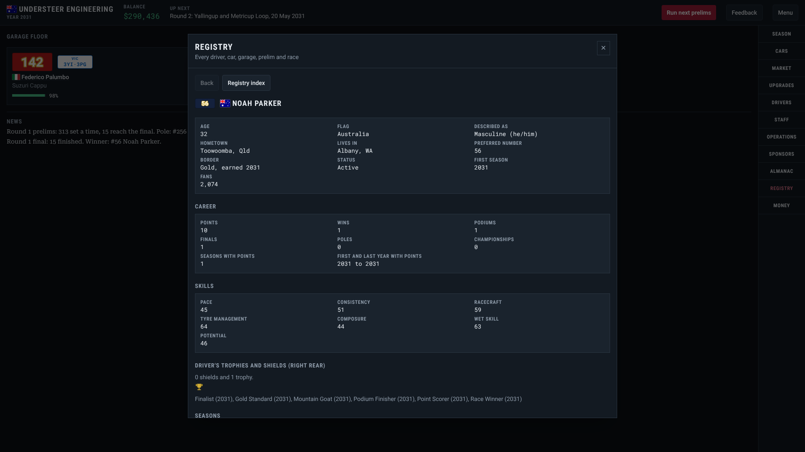
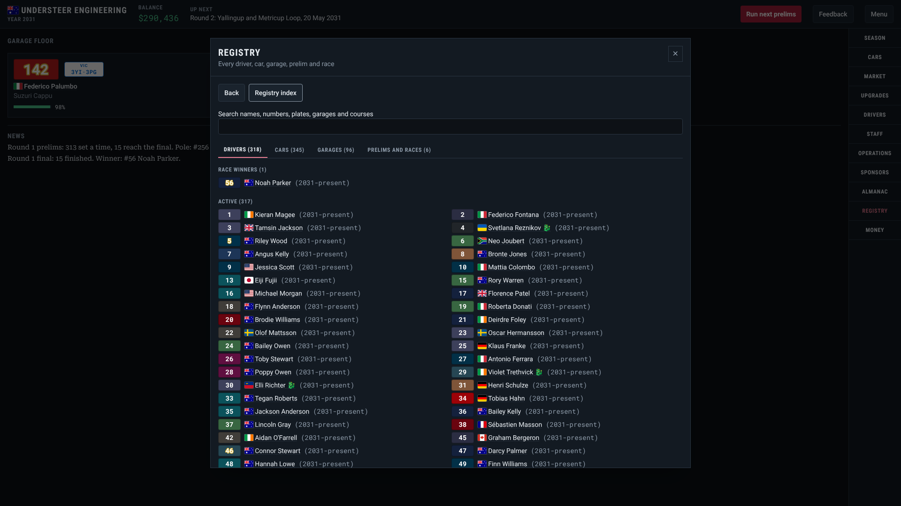

<p align="center">
  <picture>
    <source media="(prefers-color-scheme: dark)" srcset="assets/brand/logo-wordmark.svg" />
    
  </picture>
</p>

# Last Combustion

_The full name is **The Last Combustion of the Petrol Engine**._

_Racing team simulation game based in a post-petrol world, where the last petrolheads ply their craft._

Petrol is the rarest thing in the world, and a handful of people still race combustion cars on it. In 2031 they meet on closed Australian public roads for a new championship, six rounds a season, in ordinary road-legal cars. You run a garage. You buy and upgrade the cars, sign the drivers, keep the money coming in, and try to build a name that lasts through the seasons. Every driver, car, garage and race is remembered.

It is a management game first: as much a garage simulation as a racing one. The people, the parts, the suppliers and the books matter as much as the lap times. The names, the world and the branding are all original, and the idea is loosely inspired by _MF Ghost_.

**Play it:** the web build is at [lc.nexxusdrako.au](https://lc.nexxusdrako.au) and deploys from `main`. It is made for a desktop or laptop with a mouse and a large screen, not for phones. [How to play](docs/HOW_TO_PLAY.md) walks through a first season.

## Where it is

The game is being built in milestones (M0 to M8, listed in the [Game Design Document](docs/GAME_DESIGN_DOCUMENT.md)). Milestone M5, the first playable season, is built and released as **0.1.0**. It is an early version: it has one career mode and leaves out a lot of the design, so expect rough edges (see [what the first release does not have](docs/HOW_TO_PLAY.md#what-the-first-release-does-not-have)). Bugs and ideas are welcome through the Feedback button in the game or the [issue form](https://github.com/NexxusDrakoMultimedia/Last-Combustion/issues/new/choose).

You can already:

- start a Garage owner career with your own garage, flag, base state and colours, and pick a starter car and driver;
- race six rounds a season (seven days of prelims, then a final), end the season and begin the next, for as many seasons as you like;
- buy cars from dealers, the used market and the auction house, fit upgrade parts, and restore a worn chassis;
- sign drivers, train them, hire mechanics and executives, and negotiate with a title sponsor and with the suppliers of electricity, water and fuel;
- follow the standings, full race results, season awards and records, and look up any driver, car, garage or race in the Registry;
- save, load and export your career.

Still to come are the story and press layer, ownership and the cap table, facilities, the Junior Series and more career modes. The Game Design Document lists what is built and what is planned, section by section.

## Screenshots

|                                                                                                      |                                                                                                                                    |
| ---------------------------------------------------------------------------------------------------- | ---------------------------------------------------------------------------------------------------------------------------------- |
|  |  |
|                        |                                                                     |

The press kit, with the logo files, is in [docs/PRESS.md](docs/PRESS.md).

## Find us

Made by Nexxus Drako Multimedia. The same links are on the game's About screen.

- Website: [nexxusdrako.au](https://nexxusdrako.au/)
- Support the game on Ko-fi: [ko-fi.com/nexxusdrako](https://ko-fi.com/nexxusdrako)
- Bluesky: [@nexxusdrako.au](https://bsky.app/profile/nexxusdrako.au)
- Discord: [join the server](https://discord.gg/ek64RstbSX)
- GitHub: [Nexxus-Drako](https://www.github.com/Nexxus-Drako)

## Run it yourself

You need Node.js 22 and pnpm 10 (`corepack enable` sets pnpm up from `package.json`).

```bash
pnpm install
pnpm dev
```

The game is TypeScript, React, Tailwind CSS and Zustand, with SQLite (SQL.js) running in the browser as the single source of truth for the world. Electron desktop builds come later.

| Command                                                | What it does                                                          |
| ------------------------------------------------------ | --------------------------------------------------------------------- |
| `pnpm dev`                                             | Starts the game with live reload                                      |
| `pnpm build`                                           | Type-checks and builds the web app into `dist/`                       |
| `pnpm test`                                            | Unit and property tests (Vitest, fast-check)                          |
| `pnpm test:e2e`                                        | Browser tests (Playwright); build first                               |
| `pnpm lint`, `pnpm typecheck`, `pnpm format:check`     | Static checks                                                         |
| `pnpm run licenses`                                    | Checks the production dependencies for GPL-compatible licences        |
| `pnpm docs:lint`, `pnpm docs:style`, `pnpm docs:check` | Checks the Markdown, the writing style and the facts in the documents |

## Documents

| Read                                                 | For                                                          |
| ---------------------------------------------------- | ------------------------------------------------------------ |
| [How to play](docs/HOW_TO_PLAY.md)                   | A first season, the screens, a glossary and known limits     |
| [Game Design Document](docs/GAME_DESIGN_DOCUMENT.md) | The rules and numbers, the source of truth for what to build |
| [Architecture](docs/ARCHITECTURE.md)                 | How the code is organised                                    |
| [Data files](docs/DATA_FILES.md)                     | What each file in `data/` holds, and how mods use them       |
| [Press kit](docs/PRESS.md)                           | The description, facts, logo files and screenshots           |
| [Releasing](docs/RELEASING.md)                       | Versions, milestone branches and the release steps           |
| [Contributing](CONTRIBUTING.md)                      | How to help, from set-up to pull request                     |
| [Credits](CREDITS.md)                                | Third-party assets and their licences                        |
| [Trademarks](TRADEMARKS.md)                          | What is reserved and what you may do                         |
| [Security](SECURITY.md)                              | How to report a vulnerability                                |

## Privacy

The game has no accounts and no server of its own. The web build asks before it collects anonymous usage data (which buttons are used, counts and money moved, never names or save contents). Say no and nothing is sent. Local and test builds send nothing.

## Disclaimer

Last Combustion is a work of fiction. The manufacturers, cars, sponsors, suppliers, garages, drivers, executives, journalists and every other character are invented, and any resemblance to real people, living or dead, or to real companies, products, brands or events is purely coincidental. Names are made up from lists and may by chance match a real person's. Real towns and roads are used only to set the scene. No real person, brand or organisation has endorsed this game or has any connection with it.

## Contributing

Read [CONTRIBUTING.md](CONTRIBUTING.md). The project follows [Semantic Versioning](https://semver.org/), starts its [changelog](CHANGELOG.md) at the first release, and uses Conventional Commits.

## Licence

Copyright (C) Nexxus Drako Multimedia. GNU General Public License, version 3 or (at your option) any later version. See [LICENSE](LICENSE). The brand art (the logo, favicons, social cards and profile images in `assets/brand` and `public`) is licensed under [Creative Commons Attribution-ShareAlike 4.0](LICENSES/CC-BY-SA-4.0.txt), which is one-way compatible with the GPL. Screenshots of the game stay under the GPL.

The name "Last Combustion", its logo, the character Pyra Drake, the two series administrators, the four commentators and the dragon-blooded driver characters are trademarks and intellectual property of Nexxus Drako Multimedia and are not covered by the GPL grant. See [TRADEMARKS.md](TRADEMARKS.md).
